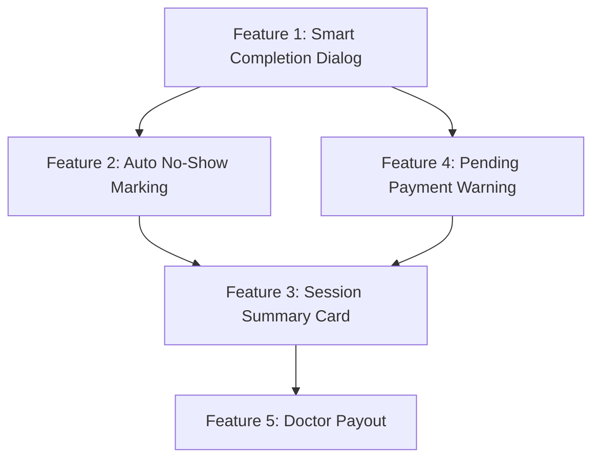

# After Doctor Schedule Completion — Feature Plan

## Background

Right now when a doctor's session ends, the staff clicks **"Complete"** on the Schedule Details page.
The API marks the schedule as `COMPLETED` — but **nothing else happens automatically**.

This plan defines all the things the frontend should handle **after a schedule is marked as completed**.

---

## What Happens Today (Current State)

```
Staff clicks "Complete"
  → API: POST /api/schedules/{id}/complete
  → toast.success("Schedule marked as completed.")
  → router.refresh()   ← page just refreshes. That's it.
```

**Problems with that:**
- Appointments still in `BOOKED` or `PENDING_PAYMENT` state → no action taken
- No-show patients are never flagged
- Doctor payout is not triggered or even reviewed
- No session summary shown to the staff
- Staff has no guidance on what to do next

---

## Open Questions

> [!IMPORTANT]
> Please answer these before we start coding — they affect core decisions.

1. **No-Show handling**: When a schedule completes, should patients who are still `BOOKED` (never served) be automatically marked as **No-Show**? Or does staff mark them manually?

2. **Pending Payment handling**: When a schedule completes, what happens to appointments with `PENDING_PAYMENT` status? Should we show a warning to collect payment first — or can they be paid later?

3. **Doctor Payout**: Is the payout to the doctor done through the system? Or is it tracked manually? Does the backend have a payout API already?

4. **Session Summary**: After completing, should a **summary report** be automatically shown (e.g., total patients served, total revenue, pending amounts)? Or is this accessed separately?

5. **Who can trigger completion?** — Currently both `ADMIN` and `STAFF` can click Complete. Should post-completion tasks (like payout) only be accessible to `ADMIN`?

---

## Proposed Changes

The plan is split into **5 feature areas**. Each one can be built independently.

---

### Feature 1 — Smart Completion Dialog (Replace `window.confirm`)

**Instead of a basic browser `confirm()` pop-up**, show a proper **MUI Dialog** before marking the schedule as complete.

This dialog will:
- Show a **pre-completion checklist** with live counts:
  - ✅ Completed appointments: `X`
  - ⚠️ Still Booked (not served): `X` → will be marked as No-Show
  - 🔴 Pending Payment: `X` → needs action
- Require staff to **confirm they understand** before proceeding
- Have two action buttons: **"Complete Session"** and **"Cancel"**

#### Files Involved

#### [NEW] `src/components/dialogs/complete-schedule/index.tsx`
- New MUI Dialog component
- Receives `scheduleId`, `appointmentSummary` as props
- Shows checklist and confirmation before calling `completeSchedule()`

#### [MODIFY] `src/views/clinic-app/appoinmentShedule/details/ScheduleDetailsSection.tsx`
- Replace `window.confirm` + direct `completeSchedule()` call with opening the new dialog

---

### Feature 2 — Auto No-Show Marking After Completion

After the schedule is completed, any appointments still in `BOOKED` status should be marked as **No-Show**.

The flow:
```
Schedule marked COMPLETED
  → Frontend checks appointments list
  → Finds all with status === 'BOOKED'
  → Calls API to mark each as NO_SHOW (or a bulk endpoint if available)
  → Shows result toast: "3 patients marked as No-Show"
```

#### Files Involved

#### [MODIFY] `src/views/clinic-app/appoinmentShedule/details/ScheduleDetailsSection.tsx`
- After `completeSchedule()` succeeds, fetch appointments and auto-mark no-shows

#### [MODIFY] `src/services/appointment/appoinment.server.service.ts`
- Add function: `markAppointmentAsNoShow(appointmentId: number)`
- Or use bulk endpoint if backend supports it

> [!NOTE]
> We need to confirm with backend whether there is a bulk no-show endpoint, or if we call per appointment.

---

### Feature 3 — Post-Completion Session Summary Panel

After completing a schedule, **instead of just refreshing the page**, show a **Session Summary Card** on the schedule details page.

The summary card shows:

| Metric | Value |
|---|---|
| Total Patients Booked | 12 |
| Patients Served | 9 |
| No-Shows | 2 |
| Cancelled | 1 |
| Total Revenue Collected | LKR 13,500.00 |
| Pending Payments | LKR 1,500.00 (1 patient) |
| Doctor Fee Due | LKR 9,000.00 |
| Clinic Revenue | LKR 4,500.00 |

#### Files Involved

#### [NEW] `src/views/clinic-app/appoinmentShedule/details/SessionSummaryCard.tsx`
- New card component rendered on the schedule details page
- Only visible when `statusCode === 'COMPLETED'`
- Fetches financial summary from the existing **Financial Overview** API

#### [MODIFY] `src/app/[lang]/(dashboard)/(clinic)/clinic/appoinment-shedule/details/[id]/page.tsx`
- Render `SessionSummaryCard` below the main schedule details when status is `COMPLETED`

---

### Feature 4 — Pending Payment Warning Before Completion

If there are appointments with `PENDING_PAYMENT` status when staff tries to complete the schedule, show a **warning alert** inside the completion dialog.

```
⚠️  Warning: 2 appointments have pending payments.
    Completing the session now will leave these unpaid.
    Please collect payment before proceeding.
    [ View Pending Payments ]   [ Complete Anyway ]
```

The **"View Pending Payments"** button filters the appointment table by `PENDING_PAYMENT` status.

#### Files Involved

#### [MODIFY] `src/components/dialogs/complete-schedule/index.tsx`
- Add warning section when `pendingPaymentCount > 0`
- Add "View Pending Payments" button that closes dialog and scrolls/filters the table

---

### Feature 5 — Doctor Payout Action (Admin Only)

After the schedule is `COMPLETED` and all payments are settled, the Admin should be able to **process the doctor's payout** directly from the schedule details page.

The payout section shows:
- Doctor's earned amount for this session
- Payout status badge (from existing `payoutStatus` field on the schedule)
- A **"Process Payout"** button (Admin only, only enabled when status is `COMPLETED` and payout is `PENDING`)

> [!IMPORTANT]
> This requires a backend payout API endpoint. We need to confirm: **does the backend already have `POST /api/payouts` or similar?** If not, this feature is blocked on the backend.

#### Files Involved

#### [NEW] `src/components/dialogs/process-payout/index.tsx`
- Dialog to confirm payout amount and method before submitting

#### [MODIFY] `src/views/clinic-app/appoinmentShedule/details/ScheduleDetailsSection.tsx`
- Add **"Process Payout"** button inside the Admin-only section
- Button only active when `statusCode === 'COMPLETED'` and `payoutStatus.code === 'PENDING'`

#### [NEW] `src/services/financial/payout.server.service.ts`
- `processDoctorPayout(scheduleId, payload)` function

---

## Implementation Order (Suggested)



| Priority | Feature | Effort | Blocked On |
|---|---|---|---|
| 1 | Smart Completion Dialog | Low | Nothing |
| 2 | Pending Payment Warning | Low | Feature 1 |
| 3 | Auto No-Show Marking | Medium | Backend confirmation |
| 4 | Session Summary Card | Medium | Nothing |
| 5 | Doctor Payout | High | Backend payout API |

---

## Verification Plan

### After Each Feature
- Manually test by creating a test schedule and marking it complete
- Verify correct appointments are flagged as no-show
- Verify summary card shows correct counts and revenue

### Final End-to-End Test
1. Create a schedule with 5 appointments
2. Mark 2 as COMPLETED, 1 as CANCELLED, leave 2 as BOOKED
3. Click "Complete Session"
4. Verify: dialog shows correct counts, warning shown for BOOKED patients
5. Confirm: 2 BOOKED → NO_SHOW automatically
6. Verify: Session summary card shows correct data
7. Admin clicks "Process Payout" → payout recorded
